# Placement Atlas
### Placement Probability & Company-Student Matching Engine

DBMS + AI/ML main project · IIIT Bhopal Training & Placement cell
**Team:** Chaitanya, Karthikeya, Kashvith, Yash Dev, Yaman Kashyap

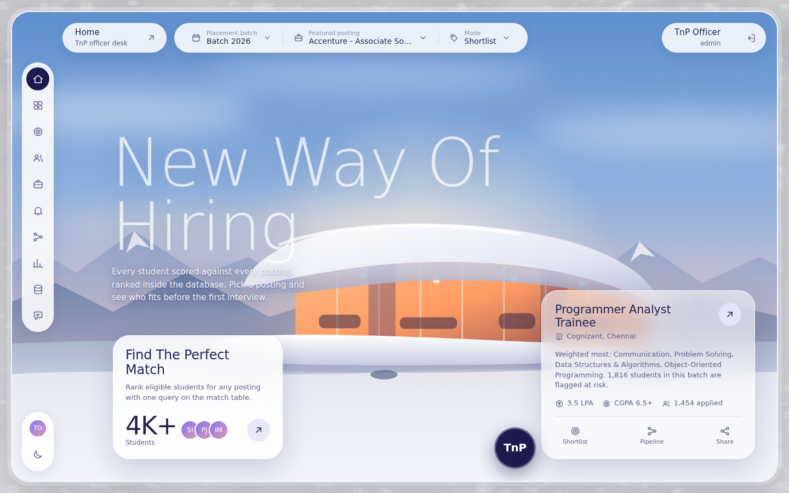

A MySQL-first placement system with a website on top. Students, skills, companies, postings, applications,
interview rounds and offers live in a normalised schema. **The database enforces the placement rules itself**
(constraints, triggers, transactional procedures), feature engineering is done in SQL views, and two ML models
write their output back into the schema, so the shortlist an officer sees is literally
`ORDER BY match_score DESC` on a table the model filled. The website gives three people their own view of the
same data: the TnP officer, the recruiter and the student.

---

## Contents
1. [What you get](#1-what-you-get)
2. [Quick start](#2-quick-start)
3. [Sign in: accounts and roles](#3-sign-in-accounts-and-roles)
4. [Website tour](#4-website-tour)
5. [How to use it: step by step](#5-how-to-use-it-step-by-step)
6. [Architecture and project layout](#6-architecture-and-project-layout)
7. [The database](#7-the-database)
8. [The ML models](#8-the-ml-models)
9. [Command reference](#9-command-reference)
10. [Configuration](#10-configuration)
11. [Testing](#11-testing)
12. [Going to production](#12-going-to-production)
13. [Troubleshooting](#13-troubleshooting)
14. [Dataset, honest limits, documentation index](#14-dataset-honest-limits-documentation-index)

---

## 1. What you get

| Layer | What is in it |
|---|---|
| **Database** | 17 tables, 12 views, 20 stored procedures, 3 functions, 13 triggers, 6 secondary indexes (each benchmarked), 20 data-quality rules, 4 least-privilege roles |
| **Data** | The supplied TnP dataset: 7,225 students (batches 2025 and 2026), 22 companies, 80 postings, 31,520 applications, 80,076 interview rounds, 7,225 outcomes |
| **Model 1: match score** | Every student scored against every posting of their cycle (289,913 rows) with weighted skill coverage; cosine and a learned model are selectable |
| **Model 2: placement probability** | Calibrated probability per student (cross-batch AUC 0.908), the basis of the early-warning list |
| **API** | 34 endpoints, a thin layer over the stored procedures (`docs/API_REFERENCE.md`) |
| **Website** | 16 pages for three roles, day/night themes, phone layout, no build step |
| **Assistant** | Plain-language questions turned into read-only SQL, plus a guarded SQL console |
| **Quality** | 54 automated tests (schema, triggers, procedures, ML, security, API), integrity checks, backup/restore scripts |

## 2. Quick start

**Requirements:** Python 3.10+, MySQL **8.0.16+** (CHECK constraints, roles, window functions, invisible
indexes). Graphviz is optional (only to redraw the ER diagram).

```bash
# 1. install
python -m pip install -r requirements.txt

# 2. configure (set TNP_ADMIN_PASSWORD to your MySQL root password; Windows: copy instead of cp)
cp .env.example .env

# 3. build everything: schema, data, checks, demo accounts, both ML models, report   (about 1.5 minutes)
python run.py all

# 4. start the website
python run.py serve
```

Open **http://127.0.0.1:8000** and click one of the demo accounts on the sign-in page.
Interactive API docs are at `/docs`.

No MySQL yet? `docker compose up -d` starts one (see `docker-compose.yml`), or install MySQL Community Server.
If your MySQL account cannot create users, run `python run.py all --no-security`.

Next time you only need `python run.py serve` (the database persists).

## 3. Sign in: accounts and roles

The sign-in page lists three one-click demo accounts. All passwords come from `.env`
(defaults below) and are meant to be changed.

| Role | Username | Default password | Sees |
|---|---|---|---|
| **TnP officer** | `admin` | `admin123` | everything |
| **Recruiter** | `recruiter1` ... `recruiter22` (one per company) | `recruiter123` | their own company's postings, shortlists and pipeline |
| **Student** | the student's e-mail address (7,225 accounts) | `student123` | only their own data |

Roles are enforced three times: by the API on every request, by ownership checks (a student cannot open another
student, a recruiter cannot open another company's posting) and by the database accounts' own privileges.
The account menu (avatar in the rail) changes your password.

## 4. Website tour

### TnP officer
| Page | What it does |
|---|---|
| **Home** | The hero scene with a featured posting. The top bar switches batch and posting; the cards jump to the shortlist or pipeline |
| **Dashboard** | KPIs, placement rate by branch, offers by CTC band, distribution of predicted probabilities, tiers, top recruiters |
| **Shortlists** | Pick a batch and posting: ranked students with match bars, fit band and application status. A second tab lists eligible students who have **not applied yet** (the outreach list). Requirements and the hiring funnel sit beside it. Export to CSV |
| **Students** | Search by name or ID, filter by batch, branch, status and CGPA. Open anyone for a 360 view: skills, matches, applications with every round, skill gaps |
| **Postings** | Every posting with eligible, applicants, selected, average match; a Companies tab; open a posting for details and to close or reopen applications |
| **Early warning** | Unplaced students under a probability threshold (slider), filtered by branch and number of applications; risk bands; CSV export |
| **Pipeline desk** | Applicants of a posting with round progress. Record interview rounds, apply a student, reopen a closed posting. A live audit trail shows what the triggers did |
| **ML insights** | Model comparison charts, the honest-vs-leaky model finding, calibration, what the model uses, run history, and buttons to re-score, retrain, process the refresh queue and regenerate the report |
| **Database health** | The 20 integrity rules, object counts, row counts, all 13 triggers, all procedures, indexes with measured speed-ups, a live EXPLAIN of the shortlist query, the ER diagram |
| **Ask the data** | Ask in words (examples included) or write a SELECT in the console. Both run on the read-only account |

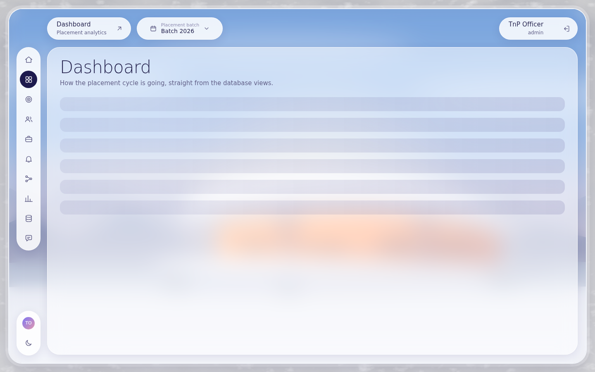
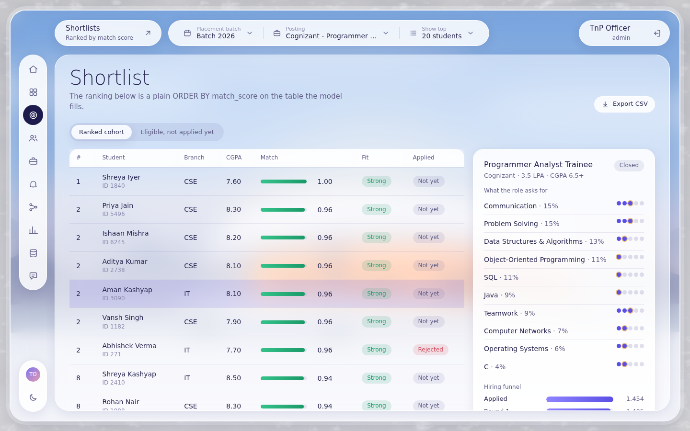
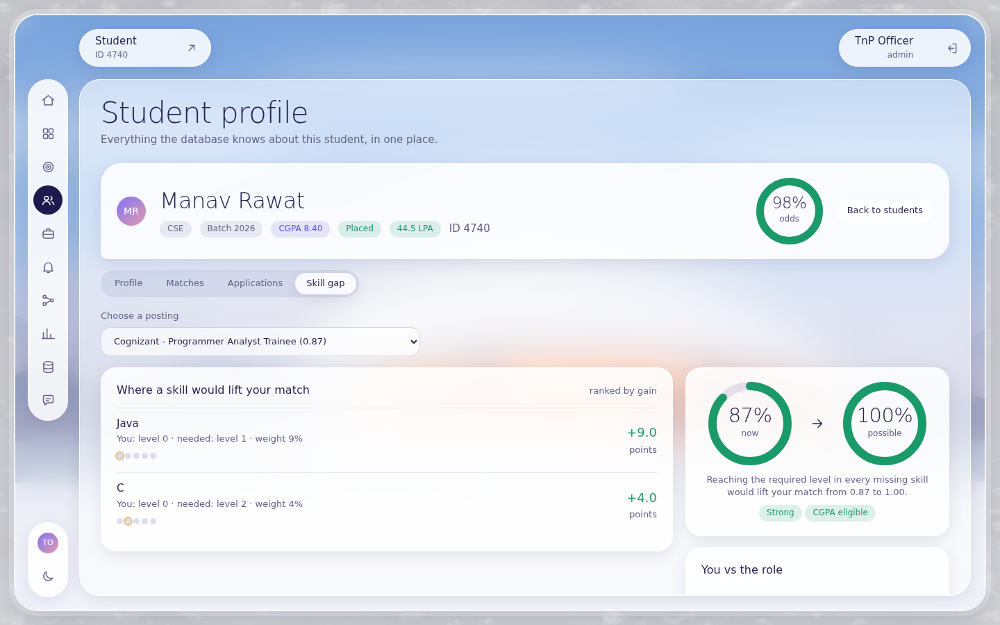
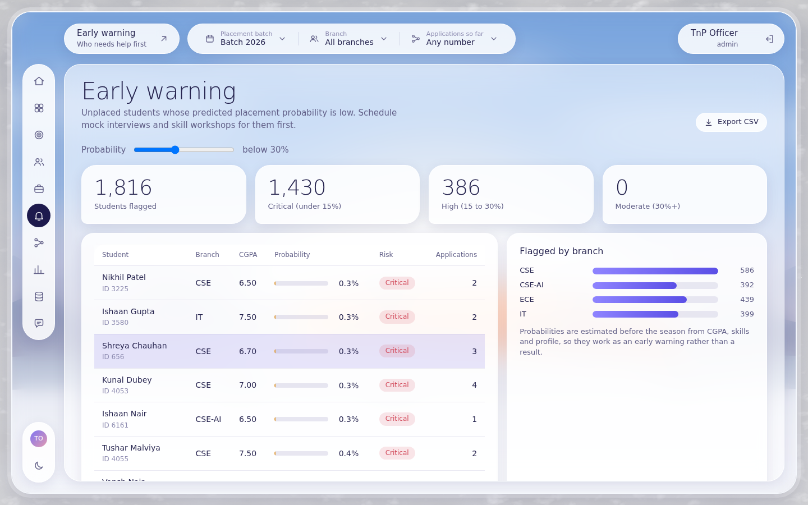
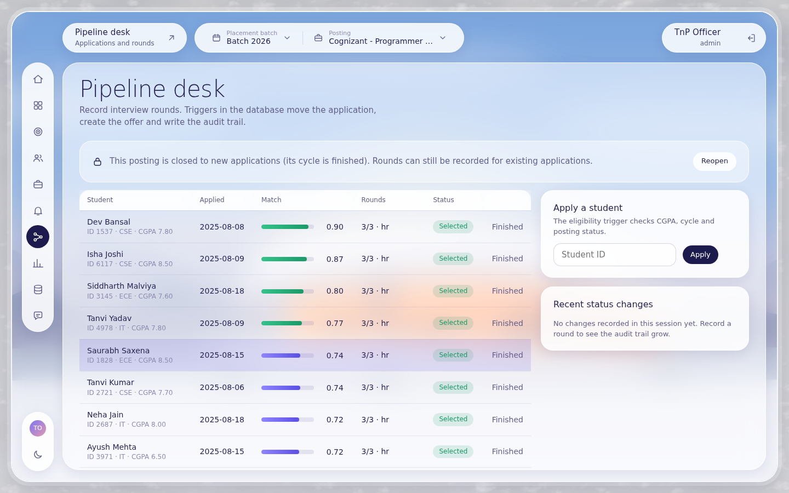
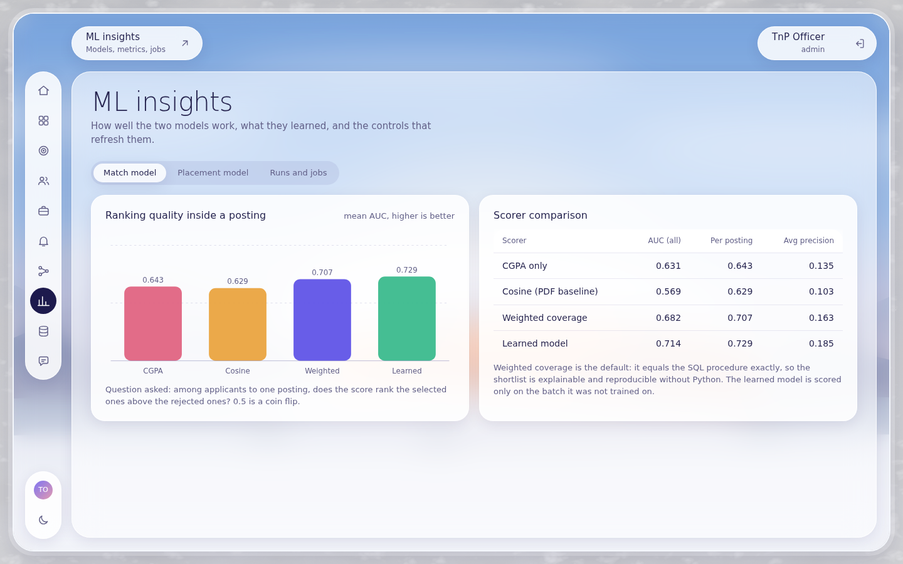
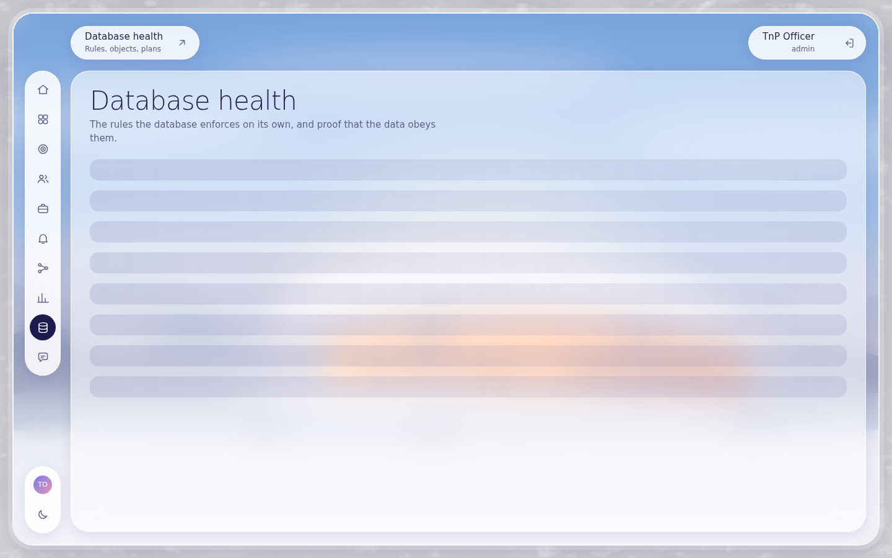
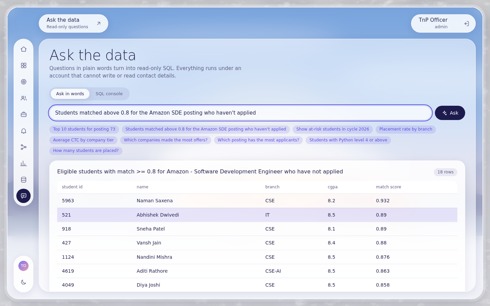

### Student
**Home** (placement odds and best match) · **My matches** (every posting of your batch, ranked, with filters
and an **Apply** button where applications are open) · **Skill coach** (which missing skill would raise a match
most, a radar of you versus the role, and the score you could reach) · **Applications** (each with its
interview timeline, withdraw while running) · **Profile** (skills with evidence, academic profile, odds).

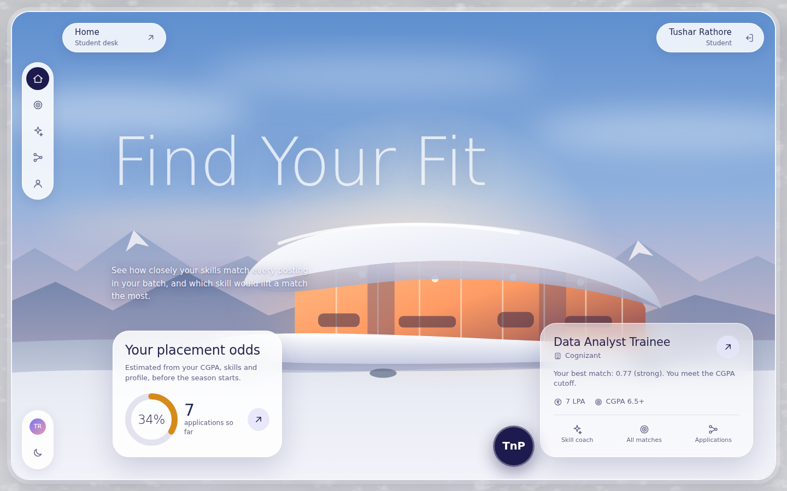
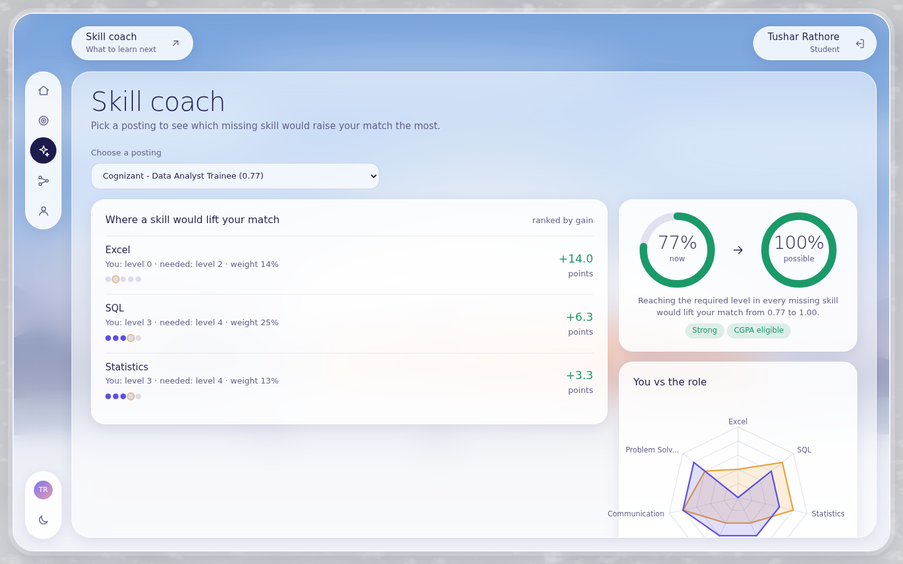

### Recruiter
**Home**, **Shortlists** and **Postings** for their own company, and the **Pipeline desk** to record interview
rounds for their applicants.

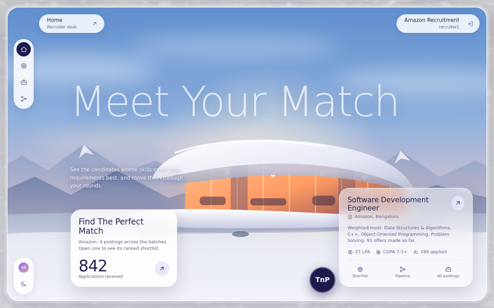

Night mode (moon icon in the rail) and phone layouts: see `docs/screenshots/12-dark-mode.png`,
`19-mobile-home.png`, `20-mobile-shortlist.png`.

## 5. How to use it: step by step

**Find who to shortlist for a company** (officer): *Shortlists*, choose batch and posting in the top bar, read the
ranking, switch to *Eligible, not applied yet* for the people to nudge, *Export CSV*.

**Help students at risk** (officer): *Early warning*, drag the probability slider, choose a branch, focus on
students with few applications, click a name to see why (skills, matches, gaps), export the list for the
workshop sign-up sheet.

**Run a live interview round** (officer or recruiter):
1. *Pipeline desk*, choose the posting. All dataset postings belong to finished cycles and are closed; press
   **Reopen** (officer) so the eligibility trigger accepts new applications.
2. **Apply a student** by ID (or sign in as that student and press Apply in *My matches*).
3. **Record round** on the new application: type, result, date. A *Pass* keeps it running, a *Reject* ends it,
   a *Select* creates the offer.
4. Watch *Recent status changes* fill: the database triggers moved the status, created the offer and wrote the
   audit row. Try recording a round on a finished application to see the rule refuse.

**Change the model** (officer): *ML insights* > *Runs and jobs* > choose *Learned model* > *Run scoring*, then
*Retrain* so probabilities follow the new match scores. The previous scores stay if the job fails.

**Keep scores fresh**: when a student's skills or a posting's requirements change in the database, triggers queue
the student/posting; *Process queue* (or `python run.py worker`) re-scores only those.

**Ask a question** (officer): *Ask the data* > click *Students matched above 0.8 for the Amazon SDE posting who
haven't applied*, or write your own SELECT in the console.

**Prepare as a student**: *My matches* > open the best posting > *Coach*: the top missing skill and the points it
would add. Learn it, then ask the officer to refresh your skills (the queue re-scores you).

## 6. Architecture and project layout

```
 browser (web/)  <--JSON-->  FastAPI (src/tnp/api)  <--SQL-->  MySQL 8
                                  |                              |  tables, constraints, 13 triggers,
                                  |                              |  20 procedures, 12 views, 4 roles
                                  +-- ML jobs (src/tnp/match.py, placement.py) --> Match_Scores,
                                      write back as the least-privilege ML account  Placement_Probability
```

```
tnp_placement_engine/
|-- run.py                    one command line for everything (section 9)
|-- sql/                      THE DBMS, executed in this order by `setup-db`
|   |-- 01_schema.sql           tables, keys, CHECKs, foreign-key actions
|   |-- 02_indexes.sql          secondary indexes (each measured)
|   |-- 03_functions.sql        fn_cycle_year, fn_is_eligible, fn_match_band
|   |-- 04_triggers.sql         13 triggers
|   |-- 05_procedures.sql       shortlist, student summary, skill gap, early warning, transactions, refresh
|   |-- 06_views.sql            ML feature views + reporting views
|   |-- 07_integrity_checks.sql v_integrity_checks (20 rules)
|   |-- 09_app_layer.sql        accounts, login audit, procedures and catalogue views for the website
|   |-- 08_security.sql         roles, users, column-level grants (applied last)
|   `-- demo_queries.sql        queries to paste live in a viva
|-- src/tnp/                  Python package
|   |-- db.py config.py setup.py loader.py users.py        connections, build, data load, demo accounts
|   |-- matrices.py match.py placement.py                   the two ML models and their write-back
|   |-- reports.py demo.py benchmark.py erdiagram.py datadict.py
|   `-- api/                  main.py routes_core.py routes_ops.py assistant.py security.py deps.py reference.py
|-- web/                      index.html + assets/{css,js,img}; js/pages/*.js one module per page
|-- data/                     the dataset CSVs (raw/, optional/)
|-- tests/                    54 pytest tests (scratch database `tnp_test`)
|-- docs/                     guides, ER diagram, data dictionary, API reference, screenshots
|-- reports/                  generated evaluation report, charts, index benchmark
|-- scripts/                  backup.sh, restore.sh
`-- Makefile  docker-compose.yml  requirements.txt  .env.example
```

## 7. The database

* **17 tables**: Students, Skills, Companies, Job_Postings, Student_Skills, Posting_Requirements, Applications,
  Interview_Rounds, Placement_Outcomes, Match_Scores, Placement_Probability, plus Model_Runs,
  Application_Status_Log, Match_Refresh_Queue, Student_Academic_Profile, App_Users, Login_Audit.
  ER diagram `docs/er_diagram.png`; every column in `docs/DATA_DICTIONARY.md`.
* **Rules the database enforces on its own:** value ranges, one application per student and posting, eligibility
  (open posting, CGPA at least the minimum, same placement cycle, sensible dates), sequential rounds, finished
  applications are immutable, a final SELECT creates the PLACED outcome, every status change is audited,
  skill edits queue a re-score.
* **SQL API used by the website:** `sp_shortlist_for_posting`, `sp_shortlist_eligible_not_applied`,
  `sp_student_application_summary`, `sp_student_matches`, `sp_skill_gap`, `sp_early_warning`,
  `sp_placement_report`, `sp_dashboard_kpis`, `sp_posting_pipeline`, `sp_apply_to_posting`, `sp_record_round`,
  `sp_withdraw_application`, `sp_open_posting`, `sp_close_posting`, refresh procedures.
* **Quality gate:** `SELECT * FROM v_integrity_checks;` (15 hard rules must be zero).
* **Evidence-based indexes:** the shortlist index makes the top-20 query about 45x faster; indexes that did not
  help were removed (`python run.py benchmark`).
* **Security:** officer, ML and read-only accounts with exactly the privileges they need; the ML account cannot
  read password hashes; setup revokes stale grants on rebuild.

Full explanation with viva answers: `docs/DBMS_CONCEPTS.md`.

## 8. The ML models

| | Model 1: match score | Model 2: placement probability |
|---|---|---|
| Question | how well do a student's skills cover a posting? | how likely is this student to be placed? |
| Default | weighted skill coverage (identical in SQL and Python) | logistic regression, 19 pre-season features |
| Result | mean per-posting AUC: CGPA 0.643, cosine 0.629, **coverage 0.707**, learned 0.729 | cross-batch AUC **0.908**, Brier 0.119, well calibrated |
| Output | `Match_Scores` | `Placement_Probability` |

**Leakage finding:** the PDF's `interview_pass_rate` feature reaches AUC 0.98 because it is computed from the
rounds that decide the label, and it cannot warn early. It is excluded from the default model.
The dataset is synthetic: these numbers show the pipeline works, not that real placements are this predictable.
Details: `docs/ML_DESIGN.md`.

## 9. Command reference

| Command | Purpose |
|---|---|
| `python run.py all` | full pipeline from scratch (**drops and recreates the database**) |
| `python run.py serve [--port 8000] [--host 127.0.0.1]` | start the website and API |
| `python run.py setup-db` | recreate database objects and roles |
| `python run.py load-data [--via-triggers]` | load the CSVs (`--via-triggers`: triggers derive statuses and offers; verified identical) |
| `python run.py seed-users` | (re)create the demo accounts |
| `python run.py check` | row counts and integrity rules (exit code 1 on failure) |
| `python run.py match [--method coverage\|cosine\|learned] [--as-ml]` | Model 1 |
| `python run.py train [--feature-set preseason\|inseason] [--as-ml]` | Model 2 |
| `python run.py worker` | process the refresh queue |
| `python run.py report` | evaluation report, charts, CSVs |
| `python run.py early-warning --cycle 2026 --threshold 0.3 --max-apps 3` | at-risk list in the terminal |
| `python run.py shortlist --posting 73 --top 15` / `student --id 1234` / `skill-gap --student 4740 --posting 73` | terminal views |
| `python run.py demo` | scripted viva demo of triggers and procedures (restores the database) |
| `python run.py benchmark` | measure every index |
| `python run.py er-diagram` / `data-dictionary` / `api-reference` | regenerate docs from the live system |
| `python -m pytest tests -q` | run the 54 tests (about a minute) |
| `scripts/backup.sh` / `scripts/restore.sh file.sql.gz [db]` | logical backup and restore |

`make all`, `make serve`, `make test` work too.

## 10. Configuration

Copy `.env.example` to `.env`. Real environment variables override it.

| Variable | Meaning |
|---|---|
| `TNP_DB_HOST`, `TNP_DB_PORT`, `TNP_DB_SOCKET`, `TNP_DB_NAME` | where the database is |
| `TNP_ADMIN_USER`, `TNP_ADMIN_PASSWORD` | account that builds the database (needs create database/user) |
| `TNP_ML_*`, `TNP_OFFICER_*`, `TNP_READONLY_*` | least-privilege accounts created by `setup-db` |
| `TNP_SECRET` | signs session tokens: **set a long random value** |
| `TNP_TOKEN_TTL_HOURS` | session lifetime (default 12) |
| `TNP_DEMO_MODE` | `1` shows demo accounts on the sign-in page, `0` hides them |
| `TNP_DEMO_*_PASSWORD` | initial passwords given by `seed-users` |

## 11. Testing

`python -m pytest tests -q` builds a scratch database `tnp_test` from the real dataset (it never touches your
data) and checks: schema inventory, row counts, constraints and cascades, every trigger, the transactional
procedures, SQL equals Python for the match score, ML calibration and the leakage finding, the privileges of all
roles (including that the ML and read-only accounts cannot read password hashes), and the API end to end:
authentication, role and ownership boundaries, the apply > round > withdraw workflow, the assistant's refusals,
and static files. 54 tests pass.

## 12. Going to production

The same checklist as `docs/WEB_APP.md`: set `TNP_SECRET`, set `TNP_DEMO_MODE=0`, change every demo password,
serve over HTTPS behind a proxy, restrict the database accounts' host, schedule `scripts/backup.sh` and
`python run.py worker`, then replace the dataset with real anonymised records and retrain.

## 13. Troubleshooting

| Symptom | Fix |
|---|---|
| `Could not connect to MySQL` | server not running or wrong `.env`; on Linux you can set `TNP_DB_SOCKET` |
| `Access denied` while creating users | use an admin account, or `python run.py all --no-security` and set `TNP_ML_USER`, `TNP_OFFICER_USER`, `TNP_READONLY_USER` to your admin user |
| Sign-in page shows no demo accounts | `TNP_DEMO_MODE=0`, or `seed-users` has not run |
| "Wrong username or password" for a student | the username is the student's e-mail; default password `student123` |
| Apply fails with "Posting is closed" | the cycle is finished; an officer must **Reopen** the posting (Pipeline desk) |
| Fonts look different | the page loads Outfit from Google Fonts and falls back to system fonts offline |
| `Students is not empty` on load | run `python run.py setup-db` first |
| CHECK constraints ignored | MySQL older than 8.0.16: upgrade |
| `log_bin_trust_function_creators` error when loading SQL by hand | `SET GLOBAL log_bin_trust_function_creators = 1;` (only when binary logging is on) |
| Port 8000 busy | `python run.py serve --port 8080` |

## 14. Dataset, honest limits, documentation index

* **Dataset:** the supplied `TnP_Dataset` (9 CSVs + optional academic profile). Original notes in
  `data/DATASET_README_original.md`. Placement cycles run August to July (`fn_cycle_year`).
* **It is synthetic.** Model scores validate the pipeline, not real-world predictability.
* **All postings are in finished cycles**, so the early-warning list is retrospective (it includes students who
  ended up unplaced) and applications need a posting to be reopened first.
* **The assistant is rule-based**: it answers the questions listed in the app and refuses the rest rather than
  guessing; the SQL console covers everything else.
* **Not included:** e-mail notifications, password reset by e-mail, file uploads (resumes are not stored).

| Document | Contents |
|---|---|
| `docs/WEB_APP.md` | website architecture, roles, design system, extension guide |
| `docs/API_REFERENCE.md` | all 34 endpoints and who may call them |
| `docs/DBMS_CONCEPTS.md` | normalisation, constraints, triggers, procedures, indexes with measurements, transactions, security |
| `docs/ML_DESIGN.md` | both models, evaluation, leakage study, limitations |
| `docs/DATA_DICTIONARY.md` | every table and column, generated from the live schema |
| `docs/PDF_COMPLIANCE.md` | the project PDF mapped to what was built, and every deviation |
| `docs/VIVA_GUIDE.md` | demo script and likely questions with answers |
| `reports/evaluation_report.md` | generated model and database evaluation |
