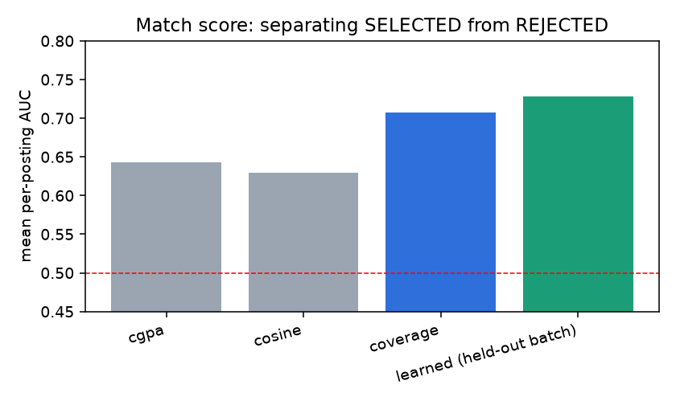
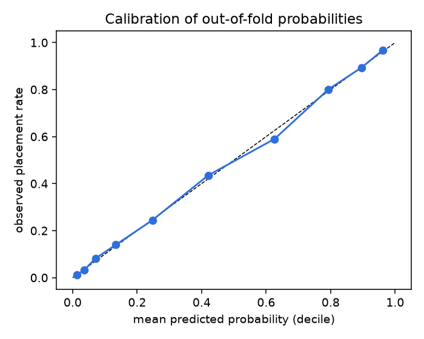
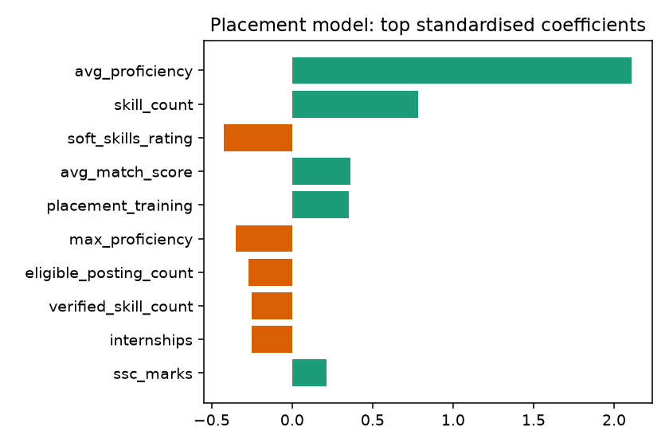

# Evaluation report

Generated 2026-10-08 17:08 from the live database.

## 1. Database health (`v_integrity_checks`)
| check_name | severity | violations | status |
|---|---|---|---|
| application below posting min CGPA | ERROR | 0 | PASS |
| application to a posting of another placement cycle | ERROR | 0 | PASS |
| application dated before its posting | ERROR | 0 | PASS |
| interview round dated before its application | ERROR | 0 | PASS |
| application whose round numbers are not 1..n | ERROR | 0 | PASS |
| REJECT/SELECT round that is not the last round | ERROR | 0 | PASS |
| SELECTED application without a SELECT round | ERROR | 0 | PASS |
| REJECTED application with rounds but no REJECT round | ERROR | 0 | PASS |
| SELECTED application whose student has no PLACED outcome | ERROR | 0 | PASS |
| PLACED outcome without a SELECTED application at that posting | ERROR | 0 | PASS |
| PLACED outcome whose offer_ctc differs from the posting CTC | ERROR | 0 | PASS |
| PLACED outcome whose offer_date differs from the SELECT round date | ERROR | 0 | PASS |
| posting whose requirement weights do not sum to 1.00 | ERROR | 0 | PASS |
| posting without any requirement | ERROR | 0 | PASS |
| Placement_Probability row outside the student's cycle | ERROR | 0 | PASS |
| student without any skill | WARN | 0 | PASS |
| student without a placement outcome row | WARN | 0 | PASS |
| running application on a CLOSED posting | WARN | 0 | PASS |
| own-cycle (student, posting) pair without a match score | WARN | 0 | PASS |
| match-refresh queue entries still PENDING | WARN | 0 | PASS |

## 2. Model 1 - skill-gap match score
Task: rank applicants of one posting; ground truth = SELECTED vs REJECTED.
`learned` is evaluated on the batch it was **not** trained on.

| scorer | auc_all_applications | avg_precision | mean_per_posting_auc | postings_evaluated |
|---|---|---|---|---|
| cgpa | 0.631 | 0.135 | 0.643 | 80 |
| cosine | 0.569 | 0.103 | 0.629 | 80 |
| coverage | 0.682 | 0.163 | 0.707 | 80 |
| learned (held-out batch) | 0.714 | 0.185 | 0.729 | 80 |

## 3. Model 2 - placement probability
Cross-batch evaluation (train on one batch year, test on the other), mean AUC:

| feature_set | model | auc |
|---|---|---|
| inseason | gradient_boosting | 0.982 |
| inseason | logistic_regression | 0.984 |
| preseason | gradient_boosting | 0.905 |
| preseason | logistic_regression | 0.908 |

`inseason` adds interview_pass_rate / rounds / applications. It reaches ~0.98 AUC because
those columns are computed from the rounds that decide the label (**leakage**); the honest
early-warning model is `preseason` (chosen model: **logistic_regression**).

Placement rate per predicted-probability decile (out-of-fold):

| decile | students | mean_prob | placed_rate |
|---|---|---|---|
| 1 | 723 | 0.013 | 0.012 |
| 2 | 722 | 0.035 | 0.032 |
| 3 | 723 | 0.071 | 0.082 |
| 4 | 722 | 0.134 | 0.140 |
| 5 | 723 | 0.248 | 0.245 |
| 6 | 722 | 0.420 | 0.435 |
| 7 | 722 | 0.626 | 0.590 |
| 8 | 723 | 0.793 | 0.801 |
| 9 | 722 | 0.895 | 0.893 |
| 10 | 723 | 0.961 | 0.967 |

## 4. Branch / batch outcomes
| batch_year | branch | students | placed | placement_pct | avg_ctc_lpa | max_ctc_lpa | avg_cgpa |
|---|---|---|---|---|---|---|---|
| 2025 | CSE | 1002 | 427 | 42.600 | 11.540 | 44.000 | 7.690 |
| 2025 | CSE-AI | 702 | 319 | 45.400 | 11.680 | 44.000 | 7.720 |
| 2025 | ECE | 747 | 318 | 42.600 | 10.190 | 44.000 | 7.730 |
| 2025 | IT | 705 | 277 | 39.300 | 11.190 | 44.000 | 7.700 |
| 2026 | CSE | 1287 | 519 | 40.300 | 11.620 | 44.500 | 7.690 |
| 2026 | CSE-AI | 887 | 365 | 41.100 | 10.790 | 44.500 | 7.700 |
| 2026 | ECE | 969 | 406 | 41.900 | 10.020 | 44.500 | 7.680 |
| 2026 | IT | 926 | 401 | 43.300 | 10.260 | 44.500 | 7.720 |

## 5. ML lineage (`Model_Runs`)
| run_id | run_kind | model_name | rows_written | status | started_at |
|---|---|---|---|---|---|
| 1 | MATCH | coverage | 289913 | SUCCESS | 2026-10-08 17:08:12 |
| 2 | PLACEMENT | logistic_regression | 7225 | SUCCESS | 2026-10-08 17:08:27 |
